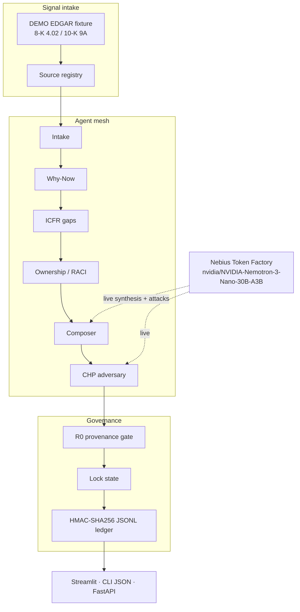

# MeshCFO Control Tower

[](LICENSE)
[](https://www.python.org/)
[](https://docs.tokenfactory.nebius.com/)
[](https://build.nvidia.com/nvidia/nemotron-3-nano-30b-a3b)
[](https://nebiusglobalaihackathon.devpost.com/)

**Cubiczan** agentic office of the CFO: turn SEC EDGAR material-weakness and restatement signals into governed remediation briefs — why now, buyer seat, ICFR gaps, next actions — with per-claim provenance.

This is MeshCFO-style **ownership**, not free-form advice.

| | |
|---|---|
| **Hackathon** | [Nebius x NVIDIA Global AI Hackathon](https://nebiusglobalaihackathon.devpost.com/) |
| **Track** | **Best Apps and Agents** |
| **Inference** | NVIDIA Nemotron on [Nebius Token Factory](https://docs.tokenfactory.nebius.com/) |
| **Primary model** | `nvidia/NVIDIA-Nemotron-3-Nano-30B-A3B` |
| **API** | `https://api.tokenfactory.nebius.com/v1/` |
| **Brand** | **Cubiczan** (spelling: C-u-b-i-c-z-a-n) |
| **License** | [MIT](LICENSE) |

**Jump:** [Problem](#1-the-problem) · [What it does](#2-what-meshcfo-control-tower-does) · [Architecture](#3-architecture) · [Nemotron + Token Factory](#4-nebius-token-factory--nvidia-nemotron) · [Track](#5-hackathon-track) · [Quickstart](#6-quickstart) · [Demo](#7-demo-walkthrough--3-minutes) · [Sample I/O](#8-sample-input--output) · [Security](#9-security) · [License](#10-license)

---

## Demo video

≤ 3 minute walkthrough (1080p MP4) for Nebius × NVIDIA · Best Apps and Agents:

- **Download (Cubiczan):** [meshcfo-control-tower-demo.mp4](https://github.com/Cubiczan/meshcfo-control-tower/releases/download/v0.1.0-demo/meshcfo-control-tower-demo.mp4) · [release v0.1.0-demo](https://github.com/Cubiczan/meshcfo-control-tower/releases/tag/v0.1.0-demo)
- **Mirror (icohangar-ops):** [meshcfo-control-tower-demo.mp4](https://github.com/icohangar-ops/meshcfo-control-tower/releases/download/v0.1.0-demo/meshcfo-control-tower-demo.mp4)
- Shot notes: [`docs/demo/README.md`](docs/demo/README.md) · script: [`DEMO.md`](DEMO.md)

Live path shown: **NVIDIA Nemotron 3 Nano** (`nvidia/NVIDIA-Nemotron-3-Nano-30B-A3B`) on **Nebius Token Factory**.


## 1. The problem

**One-liner:** An 8-K Item 4.02 or a 10-K Item 9A is a **clock**, not a chatbot prompt.

When a material weakness (MW) or restatement hits, the office of the CFO has days — not a quarter — to answer four questions an Audit Committee will actually ask:

1. **Why now?** What filing item started the amendment / certification clock?
2. **Who owns it?** Which seat is Accountable vs Responsible (not “the finance team”)?
3. **Which ICFR gaps?** COSO component, process, design vs operating?
4. **What evidence closes it?** Journals, recertification files, IA workpapers — not “look into revenue.”

Generic copilots produce paragraphs. They invent named executives, skip provenance, and cannot tell a detective compensating control from a remediated MW. That is how ICFR programs lose a year.

**MeshCFO Control Tower** is Cubiczan’s answer: a governed brief a Controller can run.

---

## 2. What MeshCFO Control Tower does

It ingests a labeled **DEMO** EDGAR-style signal (8-K Item 4.02 non-reliance, 10-K/10-Q Item 9A MW) and emits a **remediation brief** with lock state — not a chat transcript.

| Brief section | What judges should see |
|---|---|
| **Why now** | Regulatory clock from the filing item |
| **Buyer seats** | RACI on CFO / Controller / IA / SOX PMO / process owner / Audit Committee / CIO-CISO |
| **ICFR gaps** | COSO component + process + design vs operating + severity |
| **Next actions** | Owner seat + due + **evidence required** |
| **Provenance** | Every claim → agent, expansion step, epistemic tag (`verified` / `inferred` / `pattern-match`), excerpt locator |
| **CHP** | Foundation → adversarial attack → R0 gate → `EXPLORING` → `PROVISIONAL_LOCK` → `LOCKED` |

`LOCKED` is not automatic. A named third-party validator must advance `PROVISIONAL_LOCK`. Ungrounded claims are **dropped** by the R0 gate — they never enter the locked artifact.

Surfaces (same pipeline, same JSON schema):

- **CLI** `meshcfo-brief` — prints the JSON brief to stdout
- **Streamlit** control tower — judge demo
- **FastAPI** `/brief` — programmatic

DEMO fixtures are fictional issuers (`NSMT-DEMO`, `LMPC-DEMO`, `CDLH-DEMO`). They are not stand-ins for any real SEC registrant. Every excerpt starts with `DEMO FILING TEXT`.

---

## 3. Architecture



Playbooks stay deterministic (ownership and ICFR mapping never depend on a model being up). Live mode calls **NVIDIA Nemotron** on **Token Factory** to refine why-now language and CHP attacks. R0 still requires a known source id.

| Path | Role |
|---|---|
| `src/meshcfo_control_tower/llm.py` | OpenAI SDK → Token Factory |
| `playbooks.py` | Deterministic why-now / ICFR / RACI mesh |
| `pipeline.py` | Orchestrator |
| `provenance.py` | R0 gate |
| `ledger.py` | Chained HMAC-SHA256 audit log |
| `app/streamlit_app.py` | Control-tower UI |
| `fixtures/*.json` | Labeled DEMO issuers |

Optional Tavily search attaches thematic SOX/ICFR **market context**. It is labeled `market_context` and is **not** issuer evidence.

---

## 4. Nebius Token Factory + NVIDIA Nemotron

**Required inference path for the live demo.** All live LLM calls go through Token Factory’s OpenAI-compatible API. No other provider is used for synthesis.

| | |
|---|---|
| Base URL | `https://api.tokenfactory.nebius.com/v1/` |
| Auth | `NEBIUS_API_KEY` (never committed; see `.env.example`) |
| Primary model | **`nvidia/NVIDIA-Nemotron-3-Nano-30B-A3B`** |
| Fallback | `nvidia/Nemotron-3_5-Lightning` |
| Docs | [Token Factory introduction](https://docs.tokenfactory.nebius.com/api-reference/introduction) · [Switch guide](https://docs.tokenfactory.nebius.com/switch) |

**Why Nemotron (Nano) here:** Best Apps and Agents guidance is Nano/Super for fast everyday calls so the tower stays responsive and credits stretch. Nano does two jobs well in this product: (1) compress filing excerpts into an Audit Committee one-liner, (2) run the CHP adversary (“how could this brief over-claim?”). Ownership, COSO mapping, and RACI stay in playbooks so a model miss never invents a buyer seat.

```python
import os
from openai import OpenAI

client = OpenAI(
    base_url="https://api.tokenfactory.nebius.com/v1/",
    api_key=os.environ["NEBIUS_API_KEY"],
)
client.chat.completions.create(
    model="nvidia/NVIDIA-Nemotron-3-Nano-30B-A3B",
    messages=[{"role": "user", "content": "Return JSON only."}],
)
```

`--offline` runs the same brief schema without Token Factory (CI / airplane). Live mode **refines**; it does not replace the gate.

---

## 5. Hackathon track

**Nebius x NVIDIA Global AI Hackathon** · **Best Apps and Agents**.

A working app someone in the office of the CFO would actually open: Nemotron on Token Factory, a Streamlit tower, a CLI JSON brief, and governance (provenance + CHP) in front of generation.

---

## 6. Quickstart

Python 3.10+. Get a Token Factory key at [tokenfactory.nebius.com](https://tokenfactory.nebius.com/).

### uv

```bash
git clone https://github.com/Cubiczan/meshcfo-control-tower.git
cd meshcfo-control-tower
cp .env.example .env          # set NEBIUS_API_KEY=
uv venv && source .venv/bin/activate
uv pip install -e ".[dev]"
```

### pip

```bash
python3 -m venv .venv && source .venv/bin/activate
pip install -e ".[dev]"
cp .env.example .env          # set NEBIUS_API_KEY=
```

### CLI — prints a JSON brief

```bash
# Live: NVIDIA Nemotron on Nebius Token Factory
meshcfo-brief --fixture northstar

# Same schema, no API key
meshcfo-brief --fixture lumenbridge --offline --no-market
./scripts/demo.sh northstar

meshcfo-brief --list
```

### Streamlit control tower

```bash
streamlit run app/streamlit_app.py
```

### FastAPI

```bash
uvicorn meshcfo_control_tower.api:app --reload --port 8000
# GET  /health
# GET  /fixtures
# POST /brief  {"fixture_id":"northstar","offline":false}
```

| Variable | Required | Purpose |
|---|---|---|
| `NEBIUS_API_KEY` | Live demo | Token Factory auth |
| `NEBIUS_BASE_URL` | No | Default `https://api.tokenfactory.nebius.com/v1/` |
| `NEBIUS_MODEL` | No | Default `nvidia/NVIDIA-Nemotron-3-Nano-30B-A3B` |
| `NEBIUS_FALLBACK_MODEL` | No | `nvidia/Nemotron-3_5-Lightning` |
| `TAVILY_API_KEY` | No | Optional labeled market context |
| `AUDIT_LEDGER_KEY` | No | HMAC key (demo default if unset) |

```bash
pytest
```

CI runs the offline path only.

---

## 7. Demo walkthrough (≤ 3 minutes)

Full shot list and voiceover: **[`docs/DEMO.md`](docs/DEMO.md)**.

1. Open the CLI, run `meshcfo-brief --fixture northstar`, scroll `lock_state` / `buyer_seats` / `claims`.
2. Open Streamlit. Pick **Northstar Materials, Inc. (DEMO)**. Generate the brief.
3. Show why-now → ICFR gaps → buyer seats → next actions → **Per-claim provenance** → CHP lock.
4. Switch to **Lumenbridge Payments (DEMO)** (ITGC / CIO-CISO).
5. Name **Nebius Token Factory** and **NVIDIA Nemotron** twice. Never show the API key. Always say **DEMO issuer**.

Video file: [v0.1.0-demo `meshcfo-control-tower-demo.mp4`](https://github.com/Cubiczan/meshcfo-control-tower/releases/download/v0.1.0-demo/meshcfo-control-tower-demo.mp4).

---

## 8. Sample input / output

### Input (DEMO fixture, abbreviated)

`northstar` — Northstar Materials, Inc. **(DEMO)** · ticker `NSMT-DEMO` · **not a real registrant**.

```text
8-K Item 4.02 ¶1 (DEMO)
DEMO FILING TEXT — not a real EDGAR document. On March 12, 2026, the
Audit Committee of Northstar Materials, Inc. (DEMO ISSUER) concluded
that the Company's unaudited condensed consolidated financial statements
for the quarterly periods ended June 30, 2025 and September 30, 2025
should no longer be relied upon.
```

Also in the fixture: ASC 606 bill-and-hold cutoff errors and a preliminary **material weakness** over revenue cutoff controls.

### Output (`meshcfo-brief --fixture northstar --offline`)

Full frozen snapshot (visible on the default branch): [`examples/northstar-brief.offline.json`](examples/northstar-brief.offline.json). Abbreviated here:

```json
{
  "demo": true,
  "brand": "Cubiczan",
  "company": { "display_name": "Northstar Materials, Inc. (DEMO)", "ticker": "NSMT-DEMO" },
  "lock_state": "PROVISIONAL_LOCK",
  "why_now": {
    "urgency": "immediate",
    "regulatory_clock": "Immediate: non-reliance + restatement mechanics (amend prior periods, refresh 302/404 certifications, update Item 9A) before the next 10-Q/10-K."
  },
  "buyer_seats": [
    { "seat": "CFO", "raci": "A", "named_role": "Chief Financial Officer" },
    { "seat": "Controller", "raci": "R", "named_role": "Corporate Controller / CAO" },
    { "seat": "Process Owner", "raci": "R", "named_role": "Revenue process owner (order-to-cash)" }
  ],
  "icfr_gaps": [
    {
      "process": "Revenue recognition / cutoff (ASC 606 bill-and-hold)",
      "severity": "material_weakness",
      "coso_component": "Control Activities"
    }
  ],
  "next_actions": [
    {
      "owner_seat": "Controller",
      "due": "10 business days",
      "action": "Measure restatement entries for the non-reliance periods and draft the amended MD&A / footnote package.",
      "evidence_required": "Restatement bridge, journal entries, and disclosure draft cross-referenced to excerpts"
    }
  ],
  "claims": [
    {
      "text": "ICFR gap: design and operating failure over ASC 606 bill-and-hold and revenue cutoff...",
      "agent": "icfr",
      "epistemic": "verified",
      "grounding_source_ids": ["nsmt-8k-402-p2", "nsmt-10q-9a-p1"]
    }
  ],
  "chp": { "r0_passed": true, "provenance_score": 1.0 },
  "model": {
    "provider": "Nebius Token Factory",
    "base_url": "https://api.tokenfactory.nebius.com/v1/",
    "model": "nvidia/NVIDIA-Nemotron-3-Nano-30B-A3B",
    "mode": "offline"
  }
}
```

| DEMO fixture | Signal |
|---|---|
| `northstar` · Northstar Materials, Inc. (DEMO) | 8-K 4.02 + MW · ASC 606 bill-and-hold / cutoff |
| `lumenbridge` · Lumenbridge Payments Corp. (DEMO) | 10-K Item 9A · ITGC access / SOD / change |
| `cedarline` · Cedarline Health Partners (DEMO) | 8-K 4.02 + MW · inventory NRV / obsolescence |

---

## 9. Security

- **No secrets in git.** `NEBIUS_API_KEY` and optional `TAVILY_API_KEY` / `AUDIT_LEDGER_KEY` live in `.env` (gitignored). Only [`.env.example`](.env.example) is committed.
- **Do not paste keys** into Streamlit, screenshots, or the demo video.
- **DEMO fixtures only.** The loader refuses `demo=false`. Do not treat excerpts as facts about a real issuer.
- **Provenance is not a legal opinion, audit opinion, or investment advice.** R0 means “this sentence points at a source in the registry,” not “this is SOX-compliant” or “file this 8-K.”
- **Ledger.** Turns are appended to a local HMAC-SHA256 chained JSONL file (`.meshcfo/audit.jsonl`). Set `AUDIT_LEDGER_KEY` outside a demo.
- **Market context** from Tavily is thematic background. It is never used as EDGAR evidence for a DEMO issuer.

---

## 10. License

**MIT.** See [`LICENSE`](LICENSE). Copyright (c) 2026 Shyam Desigan / **Cubiczan**.

Brand spelling is **Cubiczan** — not CubicZen, not Cubic Zan.

### Cubiczan stack

This control tower is a specialized [MeshCFO](https://github.com/Cubiczan/meshcfo) surface. Pair with [CHP](https://github.com/Cubiczan/consensus-hardening-protocol), [Strata](https://github.com/Cubiczan/Strata), and [Metabocommand](https://github.com/Cubiczan/Metabocommand).
